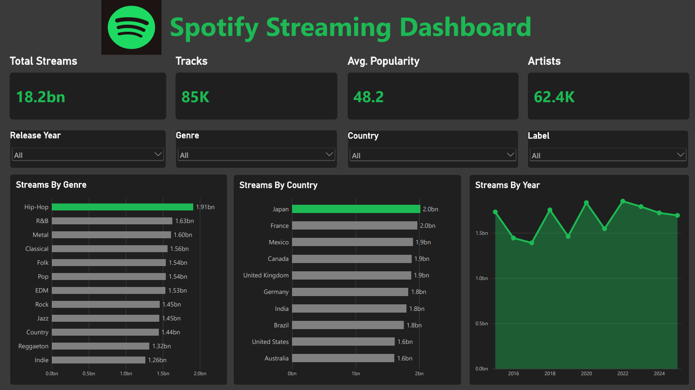
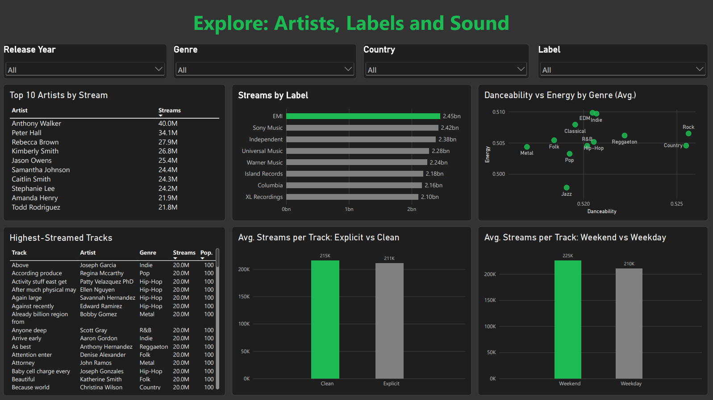

# Spotify Streaming Dashboard (Power BI)

An interactive two-page Power BI dashboard that explores about 85K tracks, 62K artists and 18.2bn streams. It answers which genres, countries and labels drive streams, and whether things like explicit content or release day make a difference.

> Unofficial portfolio project built on a sample dataset. Not affiliated with or endorsed by Spotify.

## Preview

| Overview | Explore |
|---|---|
|  |  |

A full PDF export is included: [Spotify_Streaming_Dashboard.pdf](Spotify_Streaming_Dashboard.pdf).

## What's inside

**Page 1: Overview**
- KPI cards: total streams, tracks, average popularity, unique artists
- Slicers for release year, genre, country and label (they filter every visual)
- Streams by genre, streams by country, streams by year

**Page 2: Explore**
- Top 10 artists by streams
- Streams by label
- Danceability vs energy by genre (averages)
- Highest-streamed tracks
- Average streams per track: explicit vs clean
- Average streams per track: weekend vs weekday releases

## Questions the dashboard answers
- Which genres and countries bring in the most streams?
- Who are the biggest artists and labels?
- Does explicit content or a weekend release change how many streams a track gets?
- How different do genres sound on danceability and energy?
- Are streams growing over time?

## Key findings
- **Hip-Hop leads** with about 1.91bn streams, roughly 50% more than Indie (1.26bn).
- **Japan and France** are the top countries (about 2.0bn each). The United States and Australia are lowest (about 1.6bn).
- **EMI** is the top label (2.45bn), but the eight labels shown sit within about 15% of each other.
- **Yearly streams are roughly flat**, moving between about 1.4bn and 1.85bn with no clear growth trend.
- **Explicit vs clean:** average streams per track are almost identical (about 211K explicit vs 215K clean).
- **Weekend releases** average slightly more than weekday releases (about 225K vs 210K).
- **Genres sound alike** in this data: average danceability and energy are nearly the same across all 12 genres.
- Stream counts appear to be **capped at 20M per track**, so many tracks tie at the top.

## How to open it
1. Install [Power BI Desktop](https://powerbi.microsoft.com/desktop/) (free, Windows).
2. Open `Spotify_Streaming_Dashboard.pbix`.
3. The data is already loaded inside the file. To refresh from the original CSV, go to **Home > Transform data > Data source settings** and point it to your local copy of the file.

## What I practised
- Cleaning and shaping data in Power Query (new Content Type and Release Timing columns)
- Choosing the right chart for each question (bars for rankings, line for trends, averages for fair comparisons)
- Slicers synced across pages, KPI cards, and Top N filters
- Dark theme with a single accent colour, consistent spacing and clear titles

## Notes and limitations
- The dataset is a sample, and several distributions are very even. Treat the findings as a demonstration of the analysis, not as real-world conclusions.

## Tools
Power BI Desktop, Power Query
